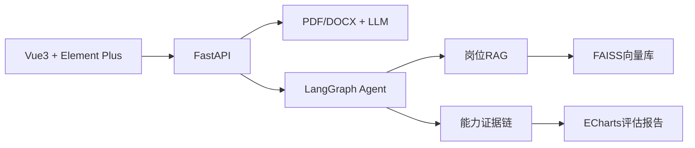
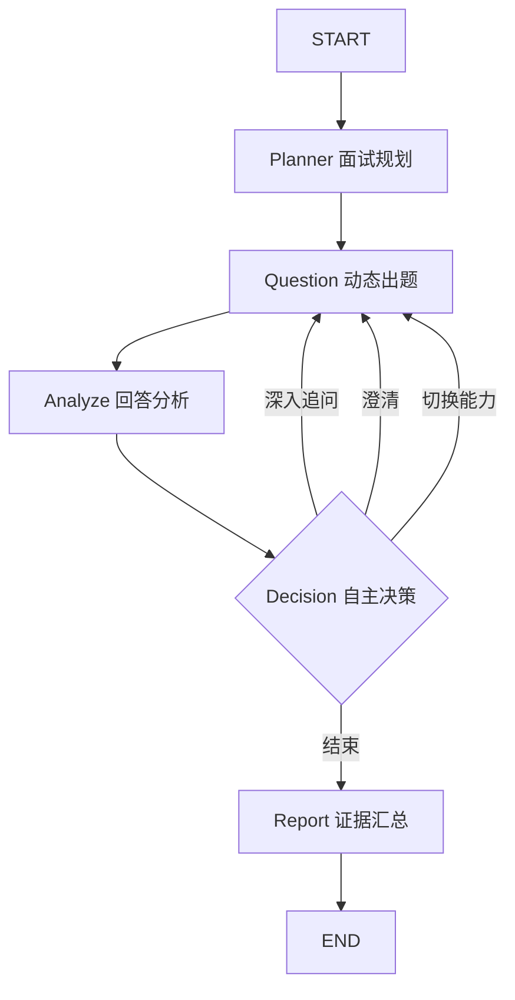

# 智面未来 - AI岗位胜任力评估智能体

Career Agent · 智面未来面向求职者、企业HR和高校就业服务场景，通过真实简历解析、岗位RAG、多轮AI面试和能力证据链评估，自动生成可解释的岗位胜任力报告。


## 核心功能

- PDF、DOCX简历解析与LLM结构化画像
- AI算法工程师、Java开发工程师、产品经理岗位知识库
- FAISS向量检索与无Embedding配置降级
- LangGraph多节点面试Agent
- 动态深入追问、澄清、能力切换和结束决策
- 能力证据时间线、雷达图、匹配度与职业建议
- 三岗位一键比赛演示数据

## 技术架构



## Agent流程



## RAG流程

```text
岗位能力文档 → 能力维度切分 → Embedding → FAISS
→ 按岗位检索考察目标/评分标准/追问方向 → 注入Agent上下文
```

## 项目结构

```text
frontend/        Vue3比赛展示系统
backend/         FastAPI、LangGraph与业务接口
  ├── app/       接口、Agent节点、服务与数据模型
  ├── tests/     单元测试与接口测试（pytest）
  └── scripts/   知识库构建与演示数据生成脚本
knowledge_base/  三岗位文档与FAISS索引
demo_data/       一键演示数据和示例简历
docs/            比赛与部署文档
.github/         CI 流水线
```

## 版本要求

- Python 3.10+（CI 与 Docker 使用 3.12）
- Node.js 20+（CI 与 Docker 使用 22）
- Docker 与 Docker Compose（可选，用于一键部署）

## 快速启动

### Docker一键启动

```bash
docker compose up --build
```

访问前端：`http://localhost:5173`  
接口文档：`http://localhost:8000/docs`

### 本地开发

```powershell
cd backend
python -m venv .venv
.venv\Scripts\Activate.ps1
pip install -r requirements.txt
uvicorn app.main:app --reload --port 8000
```

```powershell
cd frontend
npm install
npm run dev
```

复制 `backend/.env.example` 为 `backend/.env`，填写LLM和Embedding配置。未配置时系统自动使用安全降级模式，完整Demo仍可运行。

### 运行测试

```bash
cd backend
pip install -r requirements-dev.txt
pytest
```

### 重建向量库（可选）

知识库已自带索引。若修改了 `knowledge_base/source_documents/` 下的文档，
首次检索时系统会自动重建；也可手动重建：

```bash
cd backend
python scripts/build_knowledge_base.py
```

## 常见问题

**1. Windows 下路径带中文，`/api/knowledge/search` 报错？**

`faiss-cpu` 在 Windows 上使用窄字符文件 API，**无法打开含中文的索引路径**
（报错信息具有误导性，显示为 `No such file or directory`）。
程序会自动把向量库切换到系统临时目录，也可以显式指定一个纯英文目录：

```bash
VECTOR_STORE_DIR=D:\career_agent_vector_store
```

**2. 面试时 `agent_mode` 显示为 `fallback`？**

说明未连上大模型，此时走的是本地规则降级路径，流程仍可完整跑通。
按 `backend/.env.example` 填好 `LLM_BASE_URL` / `LLM_MODEL`
（如本地 Ollama：`http://localhost:11434/v1` + `qwen2.5:7b`）后，
即可看到完整的 LangGraph 多节点决策流程。

**3. `/api/knowledge/search` 返回空结果？**

向量检索属于增强能力，索引不可用时会降级为空结果而不影响接口可用性，
日志中会有对应的 warning 说明具体原因。

## 比赛演示流程

1. 首页介绍LangGraph、RAG、LLM与证据链亮点。
2. 进入简历分析，选择Java开发工程师。
3. 点击“一键加载Java开发工程师Demo”，展示结构化画像与岗位能力模型。
4. 开始AI面试，展示Agent规划、RAG增强和阶段进度。
5. 回答“我使用Spring Boot开发智能招聘系统”，展示技术点识别与事务追问。
6. 回答“使用Redis缓存热点数据”，展示缓存一致性与分布式锁追问。
7. 结束面试，展示综合评分、雷达图、证据时间线和90天提升路线。

## 安全与说明

- API密钥只从环境变量读取，不写入代码；`.env` 已在 `.gitignore` 中忽略。
- 简历临时文件在解析后删除。
- 模型和Embedding不可用时自动降级。
- RAG 检索失败时返回空结果并记录日志，不会让接口 500。
- 评估结果仅作为辅助依据，不应作为录用或淘汰的唯一依据。

## 已知限制

- 演示态的 `resume_service.latest_profile` 为进程内单例，多人并发会相互覆盖，
  生产使用需改为按会话存储。
- 面试会话保存在内存中，服务重启后失效。
- 岗位知识库目前覆盖 3 个岗位（AI算法工程师、Java开发工程师、产品经理）。
- Windows 下项目路径含中文时，faiss 索引会自动落到系统临时目录（见「常见问题」）。

## License

本项目采用 [MIT License](LICENSE)。
